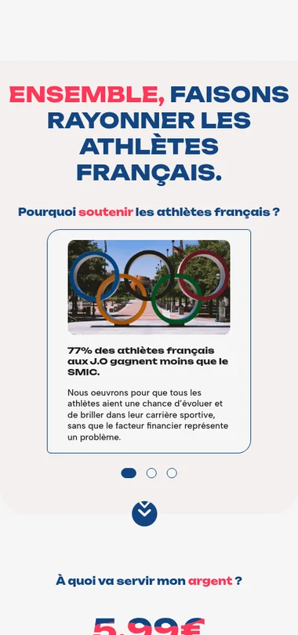
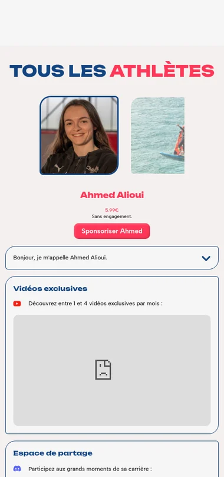
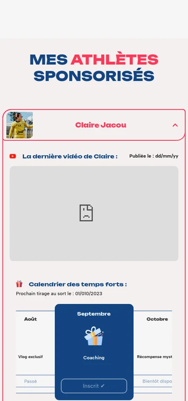

## Contexte

Obaine est une plateforme où les fans soutiennent financièrement des athlètes, en échange de contenus et d’expériences
exclusifs. Dans le cadre du lancement de l’entreprise, j’en ai développé le front-end complet à partir des maquettes de
l’équipe, pour une ouverture au public à date fixe.

## Ce que j’ai fait

Le front-end complet de la plateforme, en collaboration étroite avec un UI designer et un développeur back-end :

- les pages d’accueil, des actions et de tous les athlètes ;
- la version mobile du site ;
- la communication avec l’API et un état partagé dans l’application.

Le tout en Vue 3 avec Pinia et Vue Router, testé avec Vitest et livré dans Docker.

   

## Défis techniques

Un MVP fonctionnel en un temps record, avec une échéance stricte et une grande autonomie.

## Résultats

- Le MVP intégré en entier et fonctionnel en 2 mois.
- Plus de 100 clients sur la plateforme.

