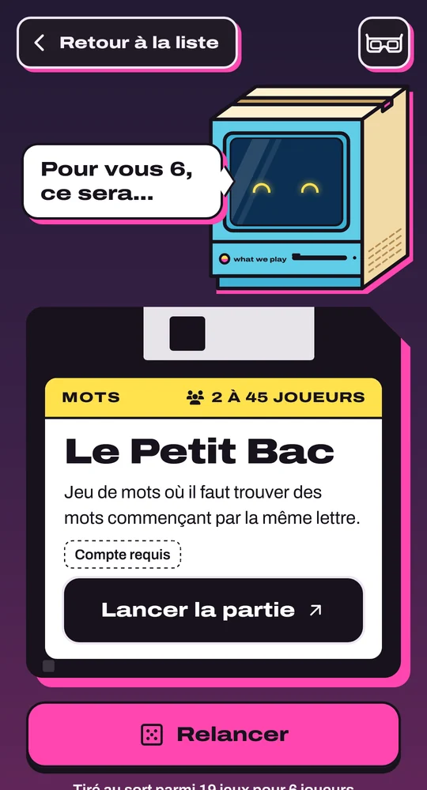
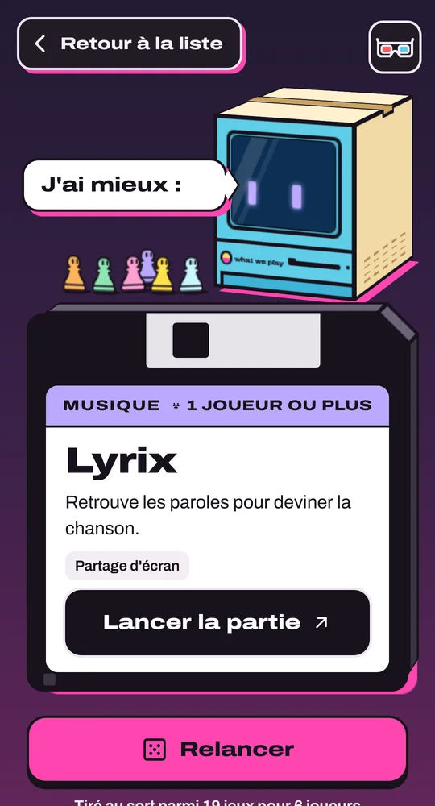

## Contexte

Un projet personnel né d’une question qui revient à chaque soirée : à quoi joue-t-on sans se prendre la tête ? Le site
répond en une touche : on donne le nombre de joueurs, il propose des jeux en ligne gratuits qui correspondent, avec la
possibilité de les filtrer selon différents critères.

## Ce que j’ai fait

Tout, de la maquette à la mise en ligne :

- la direction artistique ;
- le développement web ;
- la 3D en CSS pur ;
- la sélection des sites listés.

  

## Défis techniques

Un site agréable à utiliser, rapide sur tous les supports, optimisé pour le référencement (SEO et GEO) et
multilingue.

## Résultats

- Plus de 30 jeux sélectionnés à la main, avec des ajouts réguliers.
- Un affichage en 2D et en 3D optimisé pour tous les supports.

